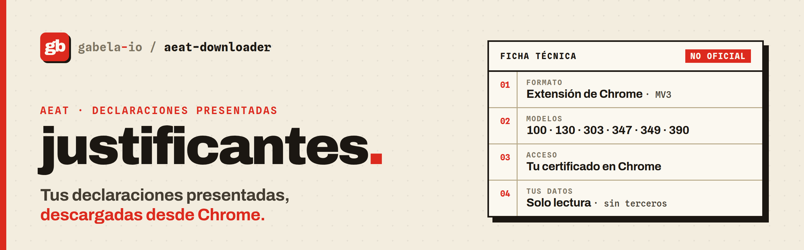

<div align="center">

<picture>
  <source media="(prefers-color-scheme: dark)" srcset=".github/assets/banner-dark.png">
  
</picture>

### Descarga los justificantes de tus declaraciones a la AEAT desde Chrome.

Consulta por modelo y ejercicio, guarda los PDF en orden y retoma donde lo dejaste.

[](build.ts)
[](#privacidad-y-seguridad)
[](flake.nix)
[](LICENSE)

[Instalación](#instalación) · [Uso](#uso) · [Privacidad](#privacidad-y-seguridad) · [Desarrollo](#desarrollo)

</div>

aeat-downloader es una extensión de Chrome que consulta las declaraciones que ya has presentado en la Agencia Tributaria y descarga sus justificantes PDF a `Descargas/AEAT/<NIF>/<ejercicio>/`. Entra con la sesión y el certificado que ya usas en Chrome, y lleva un índice local para saber qué falta por descargar.

## Por qué

En la Sede cada consulta es un modelo y un ejercicio, y cada justificante se descarga a mano. La extensión lanza todas las combinaciones en un lote y recuerda qué ha descargado, así que puedes cerrar la pestaña y seguir otro día.

> [!IMPORTANT]
> Proyecto **no oficial**, sin relación con la Agencia Tributaria ni con el Ministerio de Hacienda. Consulta el entorno de producción con tu identidad y solo lee: no firma, no presenta y no modifica declaraciones.
>
> Las pruebas usan respuestas simuladas. Falta comprobarlo con un certificado real y comparar un justificante descargado con el de la Sede.

## Funciones

- Lotes de modelos 100, 130, 303, 347, 349 y 390 para un intervalo de ejercicios, con fechas de presentación aparte (un 303 del cuarto trimestre se presenta al año siguiente).
- Cada combinación de modelo y ejercicio guarda su estado. «Reanudar consultas» repite solo las pendientes o fallidas, también después de cerrar Chrome.
- Los PDF se guardan con su huella SHA-256, y la extensión espera a que Chrome confirme cada descarga. Lo que ya está descargado no se repite en lotes nuevos.
- Búsqueda y filtros por ejercicio y estado, 25 documentos por página, tema claro y oscuro.
- Exportación del inventario a JSON y borrado del índice local.

Un error de la AEAT, una respuesta vacía o una página de acceso no cuentan como «no hay declaraciones»: la consulta queda con error y puedes repetirla. Si una consulta devuelve cien filas, puede estar truncada, y la extensión te avisa para que acotes las fechas.

## Instalación

Necesitas Chrome o Chromium 120 o posterior y [Nix](https://nixos.org/download/) con flakes:

```bash
git clone https://github.com/gabela-io/aeat-downloader
cd aeat-downloader
nix build
cp -r --no-preserve=mode result ~/aeat-downloader-ext
```

Abre `chrome://extensions`, activa el modo de desarrollador, pulsa «Cargar descomprimida» y elige `~/aeat-downloader-ext`.

Carga siempre la extensión desde la misma carpeta. Chrome calcula el ID de una extensión descomprimida a partir de su ruta, y el índice local va ligado a ese ID: si cambias de carpeta, la extensión empieza con el índice vacío. Para actualizar, reemplaza el contenido de la carpeta y pulsa «Actualizar» en `chrome://extensions`.

Si trabajas en WSL y usas Chrome de Windows, copia la carpeta a una ruta de Windows, por ejemplo `/mnt/c/Users/<usuario>/aeat-downloader-ext`, y cárgala desde allí.

## Uso

1. Pulsa el icono de la extensión. Escribe tu NIF o NIE y tus apellidos y nombre, marca los modelos y elige los ejercicios. En «Fechas de presentación», cubre también el año siguiente al último ejercicio.
2. Pulsa «Consultar AEAT» y concede el acceso a los dos dominios de la AEAT. Si Chrome pide el certificado, selecciónalo. Si la identificación falla, «Abrir acceso con certificado» abre la consulta en otra pestaña: identifícate allí y vuelve a consultar.
3. Revisa los justificantes, filtra si hace falta y pulsa «Descargar selección». Deja la pestaña abierta mientras dure el lote.
4. «Actualizar estados» compara el índice con las descargas de Chrome. Si una descarga se quedó sin confirmar, aparece como «Revisar descarga»: mira tus archivos antes de pulsar «Preparar otra descarga».

## Privacidad y seguridad

La extensión solo se conecta a dos direcciones fijas, siempre por POST y sin seguir redirecciones:

| Para qué    | Dirección                                                                                           |
| ----------- | --------------------------------------------------------------------------------------------------- |
| Consulta    | `https://www1.agenciatributaria.gob.es/wlpl/SCEJ-MANT/ConsultaExt`                                  |
| PDF por CSV | `https://www2.agenciatributaria.gob.es/wlpl/inwinvoc/es.aeat.dit.adu.eeca.catalogo.vis.VisualizaSc` |

- Pide los permisos `downloads` y `storage`. El acceso a los dos dominios de la AEAT es opcional y lo concedes al consultar por primera vez.
- Chrome gestiona el certificado. La extensión no ve la clave privada ni el PIN.
- No hay scripts remotos ni otros dominios, y nada sale hacia terceros.
- El NIF, el nombre y los identificadores de cada declaración se guardan en `chrome.storage.local` de tu perfil hasta que pulses «Borrar historial local AEAT». Los PDF siguen en Descargas. El modo incógnito tiene su propio índice.
- El inventario exportado contiene datos fiscales personales. Guárdalo junto a tus documentos.

## Desarrollo

```text
src/client.ts        # endpoints, validación del NIF y del XML, comprobación del PDF, lotes
src/app.tsx          # la página: cola persistente, bloqueo entre pestañas, descargas
src/background.ts    # el icono abre o enfoca la página
build.ts             # Bun.build y manifest.json
test/                # bun test; test/browser/ con Playwright y la extensión real
nix/                 # flake con blueprint: devshell, formatter, paquete y check de navegador
specs/               # especificaciones con Spec Kit
```

`nix develop` (o direnv) trae Bun, `tsc`, `just`, el formateador y el Chromium que usa Playwright.

```bash
just test           # tsc y pruebas unitarias
just build          # extensión en build/
just test-browser   # recorridos en Chromium con la AEAT simulada
just fmt            # nix fmt (treefmt)
just check          # nix flake check: build, pruebas, navegador y formato
```

Las pruebas usan datos inventados y bloquean la resolución DNS, así que ninguna llega a la AEAT. Las normas del proyecto están en [`AGENTS.md`](AGENTS.md) y el diseño en [`specs/001-standalone-extension`](specs/001-standalone-extension/spec.md).

## Estado

Versión 0.1.0. El código viene del «Histórico AEAT» de la extensión de facturas de autonomo, donde se diseñó y probó con respuestas simuladas. Queda pendiente una prueba con un certificado real (que Chrome lo presente en las peticiones de la extensión) y comparar un justificante descargado con el de la Sede. Los cambios están en el [CHANGELOG](CHANGELOG.md).

## Licencia

MIT. Consulta [`LICENSE`](LICENSE). `.specify/` y parte de `.claude/skills/` los genera [Spec Kit](https://github.com/github/spec-kit) (MIT); el resto de `.claude/skills/` viene de terceros (orígenes en `skills-lock.json`) y mantiene su licencia.

## Parte de gabela

aeat-downloader forma parte de [gabela](https://github.com/gabela-io): las herramientas que la administración digital debería ofrecer, pero no ofrece.

- [llave](https://github.com/gabela-io/llave), un cliente abierto de Cl@ve para terminal, escritorio y Android.
- [puntoBOE](https://github.com/gabela-io/puntoBOE), un validador de ficheros BOE que funciona en el navegador.
- [boeidl](https://github.com/gabela-io/boeidl), un compilador para los diseños de registro de la AEAT.
- [dgt-consultas-vinculantes](https://github.com/gabela-io/dgt-consultas-vinculantes), las consultas vinculantes de la DGT en abierto.
- [website](https://github.com/gabela-io/website), documentación no oficial sobre la AEAT.
